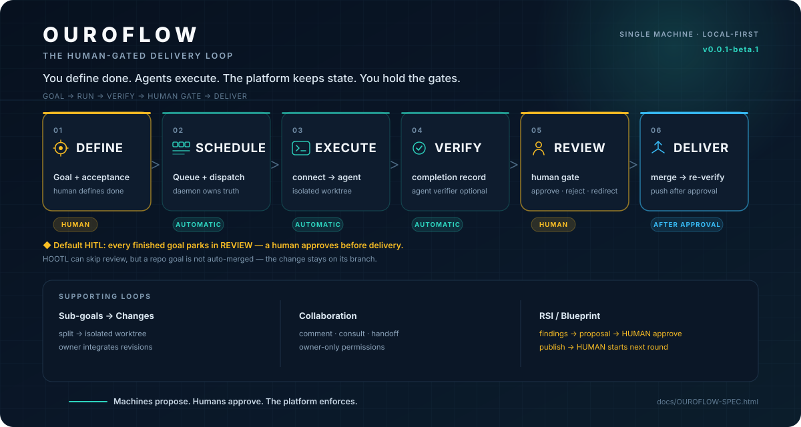

<div align="center">

# OuroFlow

**The agent delivery pipeline with human checkpoints.**<br>
You define what "done" means. Agents do the work. The platform keeps state and evidence. **You open the gates.**

`goal` → `run` → `verify` → **`review` (human)** → `deliver`

[](https://go.dev)
[](LICENSE)
[](https://github.com/Sinkear/ouroflow/releases)
[](#-quick-start)

[English](README.md) · [简体中文](README.zh.md)

[Highlights](#-highlights) · [Quick Start](#-quick-start) · [Core Concepts](#-core-concepts) · [Collaboration](#-collaboration) · [Architecture](#-architecture) · [CLI](#-cli-tool) · [Docs](#-docs-upgrades--templates) · [Tech Stack](#-tech-stack) · [Acknowledgments](#-acknowledgments)

**Single daemon · single machine · single user · local-first.** Local SQLite state, in-process event bus, Go daemon + Next.js web UI.

</div>

<div align="center">

</div>

<div align="center">
<sub>Default <b>HITL</b>: a finished goal stops at <b>review</b> for your decision. <b>HOOTL</b> skips that gate; repo-backed HOOTL branches are left unmerged.</sub>
</div>

## 🧭 It runs the loop. You hold the gates.

Most agent sessions end when the chat ends. OuroFlow keeps the work: a **goal** owns the state, a **run** is one agent's attempt in an isolated worktree, and the platform — not the agent — decides whether the goal is done.

It automates the pipeline: queueing, dispatch, retries, worktree setup, completion bookkeeping, review routing, post-approval merge/re-verify/push, and notifications.

It deliberately leaves the decisions to you: the **HITL/HOOTL** choice, review approval, Blueprint proposal adoption, version publishing, and starting the next RSI round.

> OuroFlow does **not** promise a fully autonomous software team. It will not invent the acceptance bar, approve its own proposals, or merge a repo change without a human gate.

### Three places you decide

- **Before work** — write the brief and choose **HITL** (default: a finished goal parks at `review`) or **HOOTL** (finish directly; meant for scratch or work that does not need a merge).
- **At the review gate** — **approve** emits `goal:approved` and triggers merge --no-ff, re-verify and push; **reject/redirect** sends the goal back to its owner with the reason.
- **Across rounds** — Blueprint proposals stay `pending` until a human supplies `decided_by`; a human publishes the new version and starts the next RSI round. `rsi.max_auto_rounds` only caps automatic drafting.

## 🌟 Highlights

- **Durable state, isolated execution** — goals, runs, sub-goals and changes live in SQLite; every run gets its own worktree under `$OUROFLOW_HOME/runs/<runID>`. Restart the daemon without losing the loop.
- **A real review gate** — HITL goals stop at `review` for your decision. After approval the platform merges, re-verifies and pushes. HOOTL skips the gate; repo-backed HOOTL goals are **not** auto-merged, so the branch stays for you.
- **Sub-goals + Changes** — the owner splits work into sub-goals with their own assignee and worktree. Completed sub-goals produce **Changes** with revisions; the owner integrates them, and conflicts wake the assignee to rework.
- **Collaboration without a shared chat room** — Comment / Consult / Handoff / Sub-goal, exposed through the `ouroflow` CLI. The per-run token is the only identity and owner permissions are enforced server-side.
- **Blueprint + RSI, with a human signature** — graph workflows, node-level metrics and self-iteration findings. Machines propose; humans approve proposals, publish versions and start the next round.
- **Your agent stack** — ACP / JSONL / JSON-RPC over stdio / ws / tcp, extra MCP servers, GitHub/GitCode/cron/Feishu triggers, and remote skill sync.
- **A console, not a log tail** — live event stream, execution timeline, sub-goal / change / verification panels, per-agent ACP chat, and conversation-first creation.

## 🚀 Quick Start

### Requirements

Go 1.26+, Node.js 20+/npm 10+, Git, and an ACP-capable agent CLI on the execution machine.

### From source

```bash
./build.sh                                  # build/ouroflow + build/ouroflow-daemon
./build/ouroflow-daemon                     # terminal 1 — control plane, :47813

cd web && npm install && npm run dev        # terminal 2 — web UI, :47814

./build/ouroflow connect \
  --server http://127.0.0.1:47813           # terminal 3 — execution plane
```

Open **<http://127.0.0.1:47814>**.

- `ouroflow connect` is the **execution plane**: it pulls runs, spawns the agent CLI and hosts chats. The daemon never spawns agents itself; keep `connect` running on the machine that has your agent CLIs.
- The web UI is a separate Next.js app. For a production build use `npm run build && npm start`; `./package.sh` produces a tarball with `start-all.sh` that runs both processes.
- On first launch, the web UI walks you through registering a domain (repo URL or `scratch`) and an agent. A runtime appears after `connect` probes the installed agent CLIs.

### First goal

1. Create a **domain** — a repo URL, or `scratch` for a local workspace.
2. Create or pick an **agent** from a runtime detected by `connect`.
3. Create a **goal**, write the task brief, assign the agent, and choose **HITL** (default) or **HOOTL**.
4. Watch `queued → running → review`. Inspect the report and diff, then **approve**, **reject**, or **redirect**. HOOTL goals finish directly; if the domain is repo-backed, their branch is left unmerged.

You can do the same from the CLI:

```bash
ouroflow create domain --name demo --type scratch
ouroflow create agent  --name dev --runtime <runtime-id>
ouroflow create goal   --title "build the thing" --domain demo --assignee dev
```

## 🧩 Core Concepts

<details>
<summary><b>The object model — 14 concepts, one table</b></summary>

| Concept | What it is |
|---|---|
| **Domain** (Project) | A repo-backed or scratch workspace: git URL/credentials/default branch. Acceptance is chosen per goal (HITL/HOOTL), not compiled from prose. |
| **Goal** | A work item (product plane). Status: backlog → active → review → done / failed / cancelled. The sole holder of state authority; `category` is `hitl` or `hootl`. |
| **Run** | One agent's turn on a goal. Status: queued → running → completed / failed / cancelled, plus a **role** (owner / subgoal / consult / review / verify). No authority — it reports to the goal layer. |
| **Runtime** | A launch spec — transport (stdio/ws/tcp) + provider (acp/jsonl/jsonrpc) + executable/args or endpoint + env. |
| **Agent** | A runtime + persona (system prompt / model / env / extra MCP servers / max concurrency). |
| **Chat** | A direct ACP conversation with an agent over `GET /agents/{id}/acp` — the daemon relays frames unparsed to the machine-side CLI; sessions live in the CLI's own store, permissions are answered in the panel. |
| **Squad** | A routing group that does no work itself: goals route to its leader, who delegates via sub-goals; members with role=reviewer are auto-pulled into review checkpoints. |
| **Sub-goal** | A work item split off a goal (not a child goal — no recursion). Own assignee + optional agent verifier; machine retries (≤3) and verifier rejections are counted separately. |
| **Change** | A sub-goal's logical deliverable: ready → integrating → integrated, or conflict → assignee rework → revision N+1. The owner integrates it via the `integrate_change` tool. |
| **Verifier** | A named agent issuing structured verdicts (`verify_sub_goal`). This version has no built-in domain test runner: put the real check in the brief, or add a verifier agent. |
| **Gates** | Human checkpoints: HITL review on a goal, gate nodes in a Blueprint. The old compiled gate rules (`merge`, `diff_contains`, …) are retired. |
| **Mention** | The Consult primitive: a structured URI in a comment pulls an agent into a read-only guest run; the requester resumes automatically after the answer. |
| **Schedule** | A cron template that clones a goal per firing (idempotent, timezone-aware); `category` is inherited from the template. |
| **Trigger** | Web, cron, GitHub/GitCode issues + PRs (poll, deduped by source ref; issues also webhook), Feishu IM inbound. |

</details>

## 🤝 Collaboration

<details>
<summary><b>Four behaviors, one CLI, owner permissions enforced server-side</b></summary>

| Behavior | CLI command | Who may |
|---|---|---|
| **Comment** (say) | `ouroflow goal comment --text T` | anyone |
| **Consult** (ask) | a mention in `goal comment`: `[@Name](mention://agent/<id>)` | the goal's owner |
| **Handoff** (transfer) | `ouroflow goal assign <to-agent-id> [--note N]` | the goal's owner |
| **Sub-goal** (split) | `ouroflow subgoal create --title T --assignee A` / `subgoal cancel <id>` | the goal's owner |

Agents coordinate exclusively through the `ouroflow` CLI (a shim of the daemon binary, placed on the agent's PATH at spawn). Every command carries the per-run token (`OUROFLOW_TOKEN`), which the daemon's `/rpc` endpoint resolves to the run's `(goal, agent, role)` — the token is the ONLY identity, self-reported ids are ignored, and the handoff owner check is enforced server-side. Plus `subgoal verify`, `change integrate`, and the `*_list` commands. Full model in [Collaboration.v2.md](docs/design/Collaboration.v2.md).

</details>

## 🧱 Architecture

<details>
<summary><b>The whole system on one diagram</b></summary>

```
             ┌────────────── HTTP API + WS hub ──────────────┐
             │   goals/runs/sub-goals/changes/…               │
             │   + /agents/{id}/acp (ACP chat relay)          │
             ▼                                               ▼
       service layer (state authority)                web UI (Next.js)
             │  bus.Publish (after commit)              │ ACP client (chat)
             ▼                                           │
        SQLite (truth) ── daemon scheduler ──────────────┤
                             │ run.poll / chat.*        │
                             ▼                           ▼
                      ouroflow connect   ◄──  /connect (JSON-RPC)
                             │  runTask, chat bridge (spawn + relay)
                             ▼
                      runtime.Open(spec)
                             │  acp | jsonl | jsonrpc
                             ▼
                      agent CLI subprocess ◄── ACP frames relayed unparsed
                       (stdio/ws/tcp)
                       └─ fs/terminal RPC + ouroflow CLI (/rpc)
                          (worktree, collaboration commands)
             ┌───────────────┬─────────────────────────────┐
             ▼               ▼
   completion record /   review gate → deliver
   optional verifier     (human approve → merge + re-verify + push)
```

- **Event ≠ truth** — the bus is a wakeup hint; every transition is a conditional DB transaction, idempotent under replay.
- **Two planes** — the daemon owns state, scheduling and delivery and never spawns agents; `ouroflow connect` owns execution: it holds a persistent JSON-RPC link, pulls work (`run.poll`), spawns the CLI, hosts the per-agent chat bridge, and relays ACP frames unparsed.
- **Per-run worktrees** — `$OUROFLOW_HOME/runs/<runID>` (default `~/.ouroflow`) ephemeral git worktrees against per-domain bare repos; crash recovery replays terminal runs and re-derives attention at startup.
- **Coordinator** — derived OwnerAttention (integration / recovery / user_action) wakes the owner exactly when there is work for it.

</details>

## 🔧 CLI Tool

<details>
<summary><b>Machine executor + human debugging tool</b></summary>

`ouroflow` is the **machine executor** and a human debugging tool (agents use the `ouroflow` CLI shim for collaboration):

```bash
ouroflow connect --server http://127.0.0.1:47813   # execution plane: pulls work, runs it, hosts chats
ouroflow status                                    # machine id, probed CLIs, heartbeat
ouroflow goal list --limit 5                       # debugging commands
```

The CLI defaults to `http://localhost:47813`; override with `OUROFLOW_SERVER_URL`.

</details>

## 📚 Docs, Upgrades & Templates

- **[OuroFlow project spec](docs/OUROFLOW-SPEC.html)** — the whole-project reference: product, architecture, scheduling, collaboration, delivery, Blueprint and RSI
- **[Docs index](docs/README.md)** — every other document, grouped by role (design decisions, guides, research, reports, use-cases, archive)
- [Blueprint & RSI design](docs/BLUEPRINT-PROPOSAL.md) — graph schema, node semantics, phase history and the convergence rules; current behavior lives in the spec
- [Paths and data layout](docs/PATHS.md) — every directory/env var, and what must survive an upgrade
- [Upgrade without losing data](docs/UPGRADE.md) — stop → backup → replace only bin/web → start, including JEM
- [Run identity & instruction ownership](docs/IDENTITY.md) — a run's identity comes from THIS run alone: the shared-workdir hijack postmortem and the three-layer fix
- [Turn your workflow into a template](docs/TEMPLATES.md) — export with `ouroflow-daemon export-template`
- [Artifact-swap skill](skills/ouroflow-artifact-swap/SKILL.md) — the same data-safe flow, portable to the target host
- [Design baseline](docs/design/DESIGN.md) — product & architecture decisions, invariants and boundaries (current behavior lives in the spec)
- [Collaboration model](docs/design/Collaboration.v2.md) — the full owner/role/permission model

## 🧪 Tech Stack

<details>
<summary><b>What it's built on</b></summary>

| Layer | Stack |
|---|---|
| **Backend** | Go 1.26, SQLite (modernc), gorilla/websocket, robfig/cron, MCP go-sdk |
| **Frontend** | Next.js 16, React 19, Tailwind CSS 4, TanStack React Query |
| **Protocols** | ACP, JSONL, JSON-RPC |
| **Transports** | stdio, WebSocket, TCP |
| **Notifications** | Feishu (approval cards, digest, IM inbound) |
| **Issue triggers** | GitHub, GitCode |

</details>

## 🙏 Acknowledgments

OuroFlow is an independent derivative distribution of [agentwork](https://github.com/yusheng-g/agentwork), maintained by [Sinkear](https://github.com/Sinkear).

| | |
|---|---|
| Upstream project | [yusheng-g/agentwork](https://github.com/yusheng-g/agentwork) |
| Maintainer | [Sinkear](https://github.com/Sinkear) |
| License | MIT — modifications © 2026 Sinkear, original © its authors |

---

<div align="center">

**OuroFlow** — you hold the gates, the platform runs the loop.

[⬆ Back to top](#ouroflow)

MIT © 2026 Sinkear

</div>
