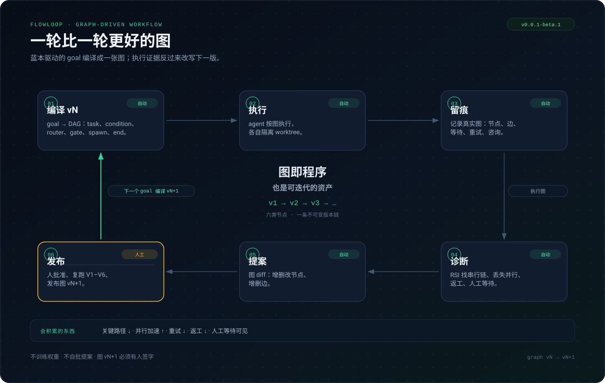

<div align="center">

# FlowLoop

**图驱动的 AI 工作流，会自我迭代。**<br>
蓝本驱动的 goal 编译成一张有版本的图。agent 执行它，平台记录真实发生的执行图。RSI 把证据变成结构性 finding 和具体的图补丁；**你批准下一个版本**——下一个 goal 就跑在更好的图上。

`Blueprint vN` → `goal` → `执行图` → `RSI findings` → `图补丁` → **`你批准`** → `Blueprint vN+1` → `下一个 goal`

[](https://go.dev)
[](LICENSE)
[](https://github.com/Sinkear/flowloop/releases)
[](#-快速开始)

[English](README.md) · [简体中文](README.zh.md)

[自迭代闭环](#-会自我迭代的工作流图) · [特性亮点](#-特性亮点) · [快速开始](#-快速开始) · [核心概念](#-核心概念) · [协作](#-协作) · [架构](#-架构) · [CLI](#-cli-工具) · [文档](#-数据升级与模板) · [技术栈](#-技术栈) · [致谢](#-致谢)

**单 daemon、单机、单用户、本地优先。** 本地 SQLite 持久化，进程内事件总线，Go daemon + Next.js Web 界面。

</div>

<div align="center">

</div>

<div align="center">
<sub><b>HITL</b> 仍是默认评审门；仓库型 <b>HOOTL</b> 分支不会自动合入。外层的自迭代闭环才是产品：每次执行都是下一版工作流图的证据。</sub>
</div>

## 🔁 会自我迭代的工作流图

多数 agent 工具调 prompt、调模型、调聊天。FlowLoop 调的是 agent 外面的**工作流图**：有哪些节点、谁依赖谁、谁跑哪条 lane、工作卡在哪、哪些门必须由人打开。

一个蓝本驱动的 goal 编译在一张**不可变的 Blueprint 版本**上——由 `task`、`condition`、`router`、`gate`、`spawn`、`end` 六类节点组成的 DAG。执行后又留下一张图：**执行图**，记录真实节点、边、等待、重试、咨询和人工门。RSI 读这张图，计算结构指标，产出 finding——串行链、丢失并行、可合并、派错人、重试放大、ping-pong、brief 质量、重复咨询等。finding 变成结构化的**图补丁**：增删改节点、增删边，附带预期效果和复测计划。

图是刻意选择的路径，不是唯一路径：`infer` goal 保留 owner 的动态拆解。平台记录它们的执行形状，连续三次同构后可起草 `v1` 蓝本——同样由人发布。这是从临时 agent 协作收敛到图的入口坡道。

### 一轮完整闭环

| # | 阶段 | 发生什么 | 谁 |
|---|---|---|---|
| 01 | **编译** | 蓝本驱动的 goal 钉住 Blueprint vN；图通过 V1–V6 校验 | 平台 |
| 02 | **执行** | agent 在隔离 worktree 里按图干活 | agent |
| 03 | **留痕** | 真实节点、边、等待、重试、咨询、人工门写成执行图 | 平台 |
| 04 | **诊断** | RSI 计算关键路径、并行加速、返工、重试放大、人工等待占比和九类 finding | RSI |
| 05 | **补丁** | finding 转成图 diff（`add_node`、`update_node`、`delete_node`、`add_edge`、`delete_edge`）；Phase D 的确定性翻译器覆盖 11 类 finding（串行链/并行化/拆分/合并/人工等待/改派/brief 加固/重试放大/咨询/乒乓/计划偏离），仍由人批准后才发布 | 机器 |
| 06 | **签字发布** | 你批准，V1–V6 复跑，**你发布** vN+1；下一个 goal 钉住它 | **你** |

版本链就是审计轨迹：`v1 → v2 → v3` 可 diff、不可变、可回滚。七个指标做 A/B——关键路径、墙钟时间、并行加速、返工率、验证通过率、验证开销、人工等待——判断新图是不是真的更好。

> 这**不是**模型训练，也**不是** prompt 自编辑。FlowLoop 只优化编排图。它从不自批提案、不自己发布版本：`decided_by` 由人填，发布由人做，下一轮 RSI 由人触发。当前分析器是确定性规则 + 统计（没有 LLM 归因），Phase E 的评测集 / best-checkpoint 闭环尚未实现。

## 🧭 底座：一条交付流水线

会自迭代的图，最终还是要交付代码。下面这层把 goal 变成工作：**goal** 持有状态，**run** 是 agent 在独立 worktree 里的一次尝试，完成与否由平台判定，而不是 agent 自说自话。

它自动化流水线：入队、派发、重试、worktree、完成记账、评审路由、批准后的合并/复验/推送，以及通知。它把决定留给人：**HITL/HOOTL** 的选择、评审批准、图补丁采纳、版本发布，以及下一轮 RSI。

> FlowLoop **不**承诺“无人值守的软件团队”。图负责提案；你负责评审、签字和发布。

### 三个需要你的位置

- **开工前** — 写清任务说明，选 **HITL**（默认：完成的 goal 停在 `review`）或 **HOOTL**（直接完成；适合 scratch 或不需要合入的工作）。
- **评审时** — **批准**会发出 `goal:approved`，触发 merge --no-ff、复验和推送；**驳回/改向**会带着理由把 goal 退回 owner。
- **版本口** — 图补丁在 `pending` 等人填 `decided_by`；V1–V6 复跑后由人发布 `vN+1`，下一个 goal 钉住它；下一轮 RSI 也由人开启。`rsi.max_auto_rounds` 只限制机器自动起草。

## 🌟 特性亮点

- **工作流自迭代** — 执行图就是反馈回路：RSI findings → 结构化图补丁 → 人批准的 `vN+1` → 下一个 goal 跑在新图上。优化的是编排，模型权重不变。
- **版本链，不是 prompt 堆** — Blueprint 版本不可变、可 diff、可回滚；七个指标让每轮可做 A/B，版本链就是 checkpoint。
- **证据来自执行，不靠猜** — 节点、边、关键路径、并行度、重试、返工、咨询和人工等待都作为事实记录；九类 finding 从图里推导。
- **状态不随聊天消失，执行彼此隔离** — goal、run、子任务和 change 都存在 SQLite；每次 run 在 `$FLOWLOOP_HOME/runs/<runID>` 下有自己的 worktree。重启 daemon 不会丢掉闭环。
- **真实的评审卡点** — HITL goal 停在 `review` 等你决定。批准后平台才合并、复验、推送。HOOTL 跳过卡点；仓库型 HOOTL **不会自动合入**，分支留给你。
- **子任务 + 变更** — owner 把活拆成有独立执行者和 worktree 的子任务。子任务完成后产出带修订的 **Change**，owner 负责整合；冲突会唤醒执行者返修。
- **不靠共享聊天室协作** — Comment / Consult / Handoff / Sub-goal，通过 `flowloop` CLI 暴露。per-run token 是唯一身份，owner 权限在服务端强制。
- **自带 agent 栈 + 控制台** — ACP / JSONL / JSON-RPC × stdio / ws / tcp，可挂额外 MCP server；支持 GitHub/GitCode/cron/飞书触发和远程技能同步；实时时间线、子任务/变更/验证面板、每 agent 的 ACP 聊天。

## 🚀 快速开始

### 环境要求

Go 1.26+、Node.js 20+/npm 10+、Git，以及执行机器上一个 ACP-capable agent CLI。

### 从源码启动

```bash
./build.sh                                  # 产出 build/flowloop + build/flowloop-daemon
./build/flowloop-daemon                     # 终端 1：控制面 :47813

cd web && npm install && npm run dev        # 终端 2：Web :47814

./build/flowloop connect \
  --server http://127.0.0.1:47813           # 终端 3：执行面
```

打开 **<http://127.0.0.1:47814>**。

- `flowloop connect` 是**执行面**：拉取 run、spawn agent CLI、托管聊天。daemon 从不自己 spawn agent；请在有 agent CLI 的机器上保持 `connect` 运行。
- Web 是独立的 Next.js 应用。生产构建用 `npm run build && npm start`；`./package.sh` 会打出带 `start-all.sh` 的 tarball，一条命令同时拉起 daemon 和 Web。
- 首次打开 Web 会引导你登记一个域（仓库 URL 或 `scratch`）和一个 agent。`connect` 探测到本机 CLI 后，对应的 runtime 才会出现。

### 第一个任务

1. 创建**域**——仓库 URL，或用于本地工作区的 `scratch`。
2. 从 `connect` 探测到的 runtime 里创建或选择一个 **agent**。
3. 创建 **goal**，写清任务说明，指派 agent，选 **HITL**（默认）或 **HOOTL**。
4. 看状态走 `queued → running → review`。检查报告和 diff，然后**批准**、**驳回**或**改向**。HOOTL goal 直接完成；如果域是仓库型，它的分支不会被合入。

也可以直接用 CLI：

```bash
flowloop create domain --name demo --type scratch
flowloop create agent  --name dev --runtime <runtime-id>
flowloop create goal   --title "把这件事做出来" --domain demo --assignee dev
```

## 🧩 核心概念

<details>
<summary><b>对象模型——16 个概念，一张表看完</b></summary>

| 概念 | 含义 |
|---|---|
| **项目（Domain）** | 仓库型或 scratch 工作区：git URL/凭据/默认分支。验收级别在 goal 上选（HITL/HOOTL），不再从自然语言编译检查。 |
| **Blueprint** | goal 编译所依据的版本化工作流图：`task`、`condition`、`router`、`gate`、`spawn`、`end`；经 V1–V6 校验，发布后不可变。一个 goal 钉住一个版本。 |
| **Goal** | 工作条目（产品面）。状态：backlog → active → review → done / failed / cancelled。状态权威的唯一持有者；`category` 为 `hitl` 或 `hootl`。 |
| **Run** | 某个 agent 在 goal 上的一次执行。状态五态 + **角色**（owner / subgoal / consult / review / verify）。无权威——终态上报 goal 层仲裁。 |
| **RSI** | 工作流级自迭代：在 `train` 模式下，完成的 goal 被冻结成执行图并计算/分析；产物是 finding 与图补丁提案。由人批准并发布。 |
| **Runtime** | 启动规格——transport（stdio/ws/tcp）+ provider（acp/jsonl/jsonrpc）+ executable/args 或 endpoint + env。 |
| **Agent** | runtime + 人设（system prompt / model / env / 额外 MCP 服务器 / 并发数）。 |
| **聊天（Chat）** | 通过 `GET /agents/{id}/acp` 与 agent 的直接 ACP 会话——daemon 把帧原样中继到机器侧 CLI；会话存于 CLI 自己的存储，权限在面板里审批。 |
| **Squad** | 路由组，不干活：goal 路由到 leader，由其拆子任务；role=reviewer 的成员在卡点时被平台自动拉入审查。 |
| **子任务（Sub-goal）** | 从 goal 拆出的工作项（不是 child goal，不可递归）。独立 assignee + 可选 agent verifier；机器重试（≤3）与验证驳回分开计数。 |
| **Change** | 子任务的逻辑交付物：ready → integrating → integrated，或 conflict → 返修 → 修订 N+1。owner 用 `integrate_change` 集成。 |
| **Verifier** | 具名 agent 通过 `verify_sub_goal` 出结构化判定。当前版本没有内置域测试执行器：真实检查要写进任务说明，或交给 verifier agent。 |
| **卡点（Gate）** | 人工检查点：goal 的 HITL 评审、蓝图里的 gate 节点。旧的编译式 gate 规则（merge、diff_contains…）已退役。 |
| **Mention** | Consult 原语：评论里的结构化 URI 把 agent 拉进只读 guest run，回答后平台自动恢复发起者。 |
| **定时任务（Schedule）** | cron 模板，每次触发克隆一个 goal（幂等、时区感知）；`category` 从模板继承。 |
| **触发渠道** | Web、cron、GitHub/GitCode issue + PR（轮询，source_ref 去重；issue 另有 webhook）、飞书入站。 |

</details>

## 🤝 协作

<details>
<summary><b>四种行为、一个 CLI、owner 权限服务端强制</b></summary>

| 行为 | CLI 命令 | 权限 |
|---|---|---|
| **Comment**（说） | `flowloop goal comment --text T` | 任何人 |
| **Consult**（问） | `goal comment` 里 mention：`[@Name](mention://agent/<id>)` | goal 的 owner |
| **Handoff**（接力） | `flowloop goal assign <to-agent-id> [--note N]` | goal 的 owner |
| **Sub-goal**（拆活） | `flowloop subgoal create --title T --assignee A` / `subgoal cancel <id>` | goal 的 owner |

agent 只通过 `flowloop` CLI（守护进程二进制的 shim，spawn 时放进 agent 的 PATH）协作。每条命令携带 per-run token（`FLOWLOOP_TOKEN`），守护进程 `/rpc` 端点将其解析为 run 的 `(goal, agent, role)`——token 是唯一身份，自报 id 被忽略，handoff 的 owner 校验在服务端强制。另有 `subgoal verify`、`change integrate` 及 `*_list` 命令。完整模型见 [Collaboration.v2.md](docs/design/Collaboration.v2.md)。

</details>

## 🧱 架构

<details>
<summary><b>一张图看全系统</b></summary>

```
             ┌────────────── HTTP API + WS hub ──────────────┐
             │   goals/runs/sub-goals/changes/…               │
             │   + /agents/{id}/acp（ACP 聊天中继）            │
             ▼                                               ▼
       service 层（状态权威）                       Web UI（Next.js）
             │  bus.Publish（commit 后）                │ ACP 客户端（聊天）
             ▼                                           │
        SQLite（真相） ── daemon 调度器 ────────────────┤
                             │ run.poll / chat.*        │
                             ▼                           ▼
                      flowloop connect   ◄──  /connect（JSON-RPC）
                             │  runTask、聊天桥（spawn + 中继）
                             ▼
                      runtime.Open(spec)
                             │  acp | jsonl | jsonrpc
                             ▼
                      agent CLI 子进程 ◄── ACP 帧原样中继
                       （stdio/ws/tcp）
                       └─ fs/terminal RPC + flowloop CLI（/rpc）
                          （worktree、协作命令）
             ┌───────────────┬─────────────────────────────┐
             ▼               ▼
      完成记录 /          评审卡点 → 交付
      可选 verifier       （人批 → 合并 + 复验 + 推送）
```

- **Event ≠ 真相** — 事件总线只是唤醒提示；一切状态转移都是条件化 DB 事务，重放幂等。
- **两个平面** — daemon 管状态、调度和交付，从不 spawn agent；`flowloop connect` 管执行：持有一条常驻 JSON-RPC 链接，拉取工作（`run.poll`），spawn CLI，托管每个 agent 的聊天桥，并原样中继 ACP 帧。
- **run 级 worktree** — `$FLOWLOOP_HOME/runs/<runID>`（默认 `~/.flowloop`）临时 git worktree，基于每域 bare 仓；崩溃恢复在启动时重放未仲裁的终态 run 并重推导 attention。
- **Coordinator** — 派生的 OwnerAttention（integration / recovery / user_action）在有活干时才唤醒 owner。

</details>

## 🔧 CLI 工具

<details>
<summary><b>机器执行器 + 人用调试工具</b></summary>

`flowloop` 既是**机器执行器**，也是人调试用的工具（agent 走 `flowloop` CLI shim 协作）：

```bash
flowloop connect --server http://127.0.0.1:47813   # 执行面：拉取 run、执行、托管聊天
flowloop status                                    # machine id、探测到的 CLI、心跳
flowloop goal list --limit 5                       # 调试命令
```

CLI 默认连 `http://localhost:47813`，可用 `FLOWLOOP_SERVER_URL` 覆盖。

</details>

## 📚 数据、升级与模板

- **[FlowLoop 项目详细说明](docs/FLOWLOOP-SPEC.html)** — 全项目总入口：产品、架构、调度、协作、交付、蓝图与 RSI
- **[文档索引](docs/README.md)** — 其余全部文档，按角色分组（决策、指南、调研、报告、真实用例、归档）
- [蓝图与 RSI 设计](docs/BLUEPRINT-PROPOSAL.md) — 图 schema、节点语义、阶段历史与收敛规则；当前行为事实以项目详细说明为准
- [路径与数据布局](docs/PATHS.md) — 每个目录/环境变量，以及升级时哪些必须保留
- [保留数据的升级](docs/UPGRADE.md) — stop → 备份 → 只换 bin/web → start，含 JEM 方案
- [Run 身份与指令归属](docs/IDENTITY.md) — run 的身份只由本次 run 定义：共用 workdir 身份劫持复盘与三层修复
- [把最佳实践做成模板](docs/TEMPLATES.md) — 用 `flowloop-daemon export-template` 导出并复用
- [制品替换 skill](skills/flowloop-artifact-swap/SKILL.md) — 同一套"不丢数据"流程，可拷到目标机器直接用
- [开发者声音（VOD）skill](skills/flowloop-vod/SKILL.md) — 把开发中发现的问题整理成「问题 / 背景 / 诉求」，直接评论到当前任务来源的 Issue（PR 来源则评论到 PR）
- [设计基线](docs/design/DESIGN.md) — 产品与架构的决策、不变量与边界（当前行为事实以项目详细说明为准）
- [协作模型](docs/design/Collaboration.v2.md) — 完整的 owner / 角色 / 权限模型

## 🧪 技术栈

<details>
<summary><b>用了什么</b></summary>

| 层 | 技术 |
|---|---|
| **后端** | Go 1.26、SQLite（modernc）、gorilla/websocket、robfig/cron、MCP go-sdk |
| **前端** | Next.js 16、React 19、Tailwind CSS 4、TanStack React Query |
| **协议** | ACP、JSONL、JSON-RPC |
| **传输** | stdio、WebSocket、TCP |
| **通知** | 飞书（审批卡、日报、IM 入站） |
| **Issue/PR 触发** | GitHub、GitCode |

</details>

## 🙏 致谢

FlowLoop 是 [agentwork](https://github.com/yusheng-g/agentwork) 的独立衍生发行版，由 [Sinkear](https://github.com/Sinkear) 维护。

| | |
|---|---|
| 上游项目 | [yusheng-g/agentwork](https://github.com/yusheng-g/agentwork) |
| 维护者 | [Sinkear](https://github.com/Sinkear) |
| 许可证 | MIT — 修改部分 © 2026 Sinkear，原始部分版权归原作者 |

---

<div align="center">

**FlowLoop** — 图负责提案，你负责签字。每一轮都跑在更好的工作流上。

[⬆ 回到顶部](#flowloop)

MIT © 2026 Sinkear

</div>
