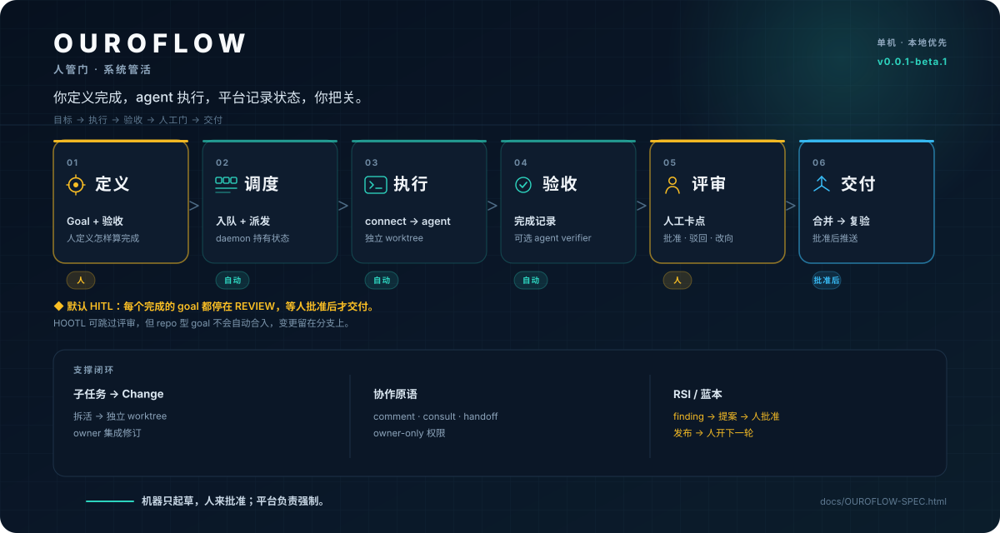

<div align="center">

# OuroFlow

**给 CLI agent 的人类把关交付流水线。**<br>
你定义“怎样算完成”，agent 干活，平台记录状态与证据，**你决定门开不开**。

`goal` → `run` → 完成记录 → **评审（人）** → 交付

[](https://go.dev)
[](LICENSE)
[](https://github.com/Sinkear/ouroflow/releases)
[](#-快速开始)

[English](README.md) · [简体中文](README.zh.md)

[特性亮点](#-特性亮点) · [快速开始](#-快速开始) · [核心概念](#-核心概念) · [协作](#-协作) · [架构](#-架构) · [CLI](#-cli-工具) · [文档](#-数据升级与模板) · [技术栈](#-技术栈) · [致谢](#-致谢)

**单 daemon、单机、单用户、本地优先。** 本地 SQLite 持久化，进程内事件总线，Go daemon + Next.js Web 界面。

</div>

<div align="center">

</div>

<div align="center">
<sub>默认 <b>HITL</b>：目标完成后停在 <b>review</b> 等你决定。<b>HOOTL</b> 跳过此门；仓库型 HOOTL 的分支不会自动合入。</sub>
</div>

## 🧭 它跑闭环，你掌闸门

大多数 agent 会话在聊天结束时就断了。OuroFlow 把工作留下来：**goal** 持有状态，**run** 是 agent 在独立 worktree 里的一次尝试，完成与否由平台判定，而不是 agent 自说自话。

它自动化流水线：入队、派发、重试、worktree、完成记账、评审路由、批准后的合并/复验/推送，以及通知。

它把决定留给人：**HITL/HOOTL** 的选择、评审批准、蓝图提案采纳、版本发布，以及下一轮 RSI。

> OuroFlow **不**承诺“无人值守的软件团队”。它不会替你定验收标准，不会自批提案，也不会在没有人工卡点的情况下把仓库改动合进去。

### 三个需要你的位置

- **开工前** — 写清任务说明，选 **HITL**（默认：完成的 goal 停在 `review`）或 **HOOTL**（直接完成；适合 scratch 或不需要合入的工作）。
- **评审时** — **批准**会发出 `goal:approved`，触发 merge --no-ff、复验和推送；**驳回/改向**会带着理由把 goal 退回 owner。
- **迭代间** — 蓝图提案在 `pending` 等人填 `decided_by`；版本由人发布，下一轮 RSI 由人点。`rsi.max_auto_rounds` 只限制机器自动起草的轮数。

## 🌟 特性亮点

- **状态不随聊天消失，执行彼此隔离** — goal、run、子任务和 change 都存在 SQLite；每次 run 在 `$OUROFLOW_HOME/runs/<runID>` 下有自己的 worktree。重启 daemon 不会丢掉闭环。
- **真实的评审卡点** — HITL goal 停在 `review` 等你决定。批准后平台才合并、复验、推送。HOOTL 跳过卡点；仓库型 HOOTL **不会自动合入**，分支留给你。
- **子任务 + 变更** — owner 把活拆成有独立执行者和 worktree 的子任务。子任务完成后产出带修订的 **Change**，owner 负责整合；冲突会唤醒执行者返修。
- **不靠共享聊天室协作** — Comment / Consult / Handoff / Sub-goal，通过 `ouroflow` CLI 暴露。per-run token 是唯一身份，owner 权限在服务端强制。
- **蓝图 + RSI，机器起草、人签字** — 图工作流、节点级指标、自迭代发现。机器出提案；人批准提案、发布版本、开启下一轮。
- **自带 agent 栈** — ACP / JSONL / JSON-RPC × stdio / ws / tcp，可挂额外 MCP server；支持 GitHub/GitCode/cron/飞书触发和远程技能同步。
- **控制台，而不是日志尾巴** — 实时事件流、执行时间线、子任务 / 变更 / 验证面板、每 agent 的 ACP 聊天，以及对话式创建。

## 🚀 快速开始

### 环境要求

Go 1.26+、Node.js 20+/npm 10+、Git，以及执行机器上一个 ACP-capable agent CLI。

### 从源码启动

```bash
./build.sh                                  # 产出 build/ouroflow + build/ouroflow-daemon
./build/ouroflow-daemon                     # 终端 1：控制面 :47813

cd web && npm install && npm run dev        # 终端 2：Web :47814

./build/ouroflow connect \
  --server http://127.0.0.1:47813           # 终端 3：执行面
```

打开 **<http://127.0.0.1:47814>**。

- `ouroflow connect` 是**执行面**：拉取 run、spawn agent CLI、托管聊天。daemon 从不自己 spawn agent；请在有 agent CLI 的机器上保持 `connect` 运行。
- Web 是独立的 Next.js 应用。生产构建用 `npm run build && npm start`；`./package.sh` 会打出带 `start-all.sh` 的 tarball，一条命令同时拉起 daemon 和 Web。
- 首次打开 Web 会引导你登记一个域（仓库 URL 或 `scratch`）和一个 agent。`connect` 探测到本机 CLI 后，对应的 runtime 才会出现。

### 第一个任务

1. 创建**域**——仓库 URL，或用于本地工作区的 `scratch`。
2. 从 `connect` 探测到的 runtime 里创建或选择一个 **agent**。
3. 创建 **goal**，写清任务说明，指派 agent，选 **HITL**（默认）或 **HOOTL**。
4. 看状态走 `queued → running → review`。检查报告和 diff，然后**批准**、**驳回**或**改向**。HOOTL goal 直接完成；如果域是仓库型，它的分支不会被合入。

也可以直接用 CLI：

```bash
ouroflow create domain --name demo --type scratch
ouroflow create agent  --name dev --runtime <runtime-id>
ouroflow create goal   --title "把这件事做出来" --domain demo --assignee dev
```

## 🧩 核心概念

<details>
<summary><b>对象模型——一张表看完</b></summary>

| 概念 | 含义 |
|---|---|
| **项目（Domain）** | 仓库型或 scratch 工作区：git URL/凭据/默认分支。验收级别在 goal 上选（HITL/HOOTL），不再从自然语言编译检查。 |
| **Goal** | 工作条目（产品面）。状态：backlog → active → review → done / failed / cancelled。状态权威的唯一持有者；`category` 为 `hitl` 或 `hootl`。 |
| **Run** | 某个 agent 在 goal 上的一次执行。状态五态 + **角色**（owner / subgoal / consult / review / verify）。无权威——终态上报 goal 层仲裁。 |
| **Runtime** | 启动规格——transport（stdio/ws/tcp）+ provider（acp/jsonl/jsonrpc）+ executable/args 或 endpoint + env。 |
| **Agent** | runtime + 人设（system prompt / model / env / 额外 MCP 服务器 / 并发数）。 |
| **聊天（Chat）** | 通过 `GET /agents/{id}/acp` 与 agent 的直接 ACP 会话——daemon 把帧原样中继到机器侧 CLI；会话存于 CLI 自己的存储，权限在面板里审批。 |
| **Squad** | 路由组，不干活：goal 路由到 leader，由其拆子任务；role=reviewer 的成员在卡点时被平台自动拉入审查。 |
| **子任务（Sub-goal）** | 从 goal 拆出的工作项（不是 child goal，不可递归）。独立 assignee + 可选 agent verifier；机器重试（≤3）与验证驳回分开计数。 |
| **Change** | 子任务的逻辑交付物：ready → integrating → integrated，或 conflict → 返修 → 修订 N+1。owner 用 `integrate_change` 集成。 |
| **Verifier** | 具名 agent 通过 `verify_sub_goal` 出结构化判定。当前版本没有内置域测试执行器：真实检查要写进任务说明，或交给 verifier agent。 |
| **卡点（Gate）** | 人工检查点：goal 的 HITL 评审、蓝图里的 gate 节点。旧的编译式 gate 规则（merge、diff_contains…）已退役。 |
| **Mention** | Consult 原语：评论里的结构化 URI 把 agent 拉进只读 guest run，回答后平台自动恢复发起者。 |
| **定时任务（Schedule）** | cron 模板，每次触发克隆一个 goal（幂等、时区感知）；`category` 从模板继承。 |
| **触发渠道** | Web、cron、GitHub/GitCode issue + PR（轮询，source_ref 去重；issue 另有 webhook）、飞书入站。 |

</details>

## 🤝 协作

<details>
<summary><b>四种行为、一个 CLI、owner 权限服务端强制</b></summary>

| 行为 | CLI 命令 | 权限 |
|---|---|---|
| **Comment**（说） | `ouroflow goal comment --text T` | 任何人 |
| **Consult**（问） | `goal comment` 里 mention：`[@Name](mention://agent/<id>)` | goal 的 owner |
| **Handoff**（接力） | `ouroflow goal assign <to-agent-id> [--note N]` | goal 的 owner |
| **Sub-goal**（拆活） | `ouroflow subgoal create --title T --assignee A` / `subgoal cancel <id>` | goal 的 owner |

agent 只通过 `ouroflow` CLI（守护进程二进制的 shim，spawn 时放进 agent 的 PATH）协作。每条命令携带 per-run token（`OUROFLOW_TOKEN`），守护进程 `/rpc` 端点将其解析为 run 的 `(goal, agent, role)`——token 是唯一身份，自报 id 被忽略，handoff 的 owner 校验在服务端强制。另有 `subgoal verify`、`change integrate` 及 `*_list` 命令。完整模型见 [Collaboration.v2.md](docs/design/Collaboration.v2.md)。

</details>

## 🧱 架构

<details>
<summary><b>一张图看全系统</b></summary>

```
             ┌────────────── HTTP API + WS hub ──────────────┐
             │   goals/runs/sub-goals/changes/…               │
             │   + /agents/{id}/acp（ACP 聊天中继）            │
             ▼                                               ▼
       service 层（状态权威）                       Web UI（Next.js）
             │  bus.Publish（commit 后）                │ ACP 客户端（聊天）
             ▼                                           │
        SQLite（真相） ── daemon 调度器 ────────────────┤
                             │ run.poll / chat.*        │
                             ▼                           ▼
                      ouroflow connect   ◄──  /connect（JSON-RPC）
                             │  runTask、聊天桥（spawn + 中继）
                             ▼
                      runtime.Open(spec)
                             │  acp | jsonl | jsonrpc
                             ▼
                      agent CLI 子进程 ◄── ACP 帧原样中继
                       （stdio/ws/tcp）
                       └─ fs/terminal RPC + ouroflow CLI（/rpc）
                          （worktree、协作命令）
             ┌───────────────┬─────────────────────────────┐
             ▼               ▼
      完成记录 /          评审卡点 → 交付
      可选 verifier       （人批 → 合并 + 复验 + 推送）
```

- **Event ≠ 真相** — 事件总线只是唤醒提示；一切状态转移都是条件化 DB 事务，重放幂等。
- **两个平面** — daemon 管状态、调度和交付，从不 spawn agent；`ouroflow connect` 管执行：持有一条常驻 JSON-RPC 链接，拉取工作（`run.poll`），spawn CLI，托管每个 agent 的聊天桥，并原样中继 ACP 帧。
- **run 级 worktree** — `$OUROFLOW_HOME/runs/<runID>`（默认 `~/.ouroflow`）临时 git worktree，基于每域 bare 仓；崩溃恢复在启动时重放未仲裁的终态 run 并重推导 attention。
- **Coordinator** — 派生的 OwnerAttention（integration / recovery / user_action）在有活干时才唤醒 owner。

</details>

## 🔧 CLI 工具

<details>
<summary><b>机器执行器 + 人用调试工具</b></summary>

`ouroflow` 既是**机器执行器**，也是人调试用的工具（agent 走 `ouroflow` CLI shim 协作）：

```bash
ouroflow connect --server http://127.0.0.1:47813   # 执行面：拉取 run、执行、托管聊天
ouroflow status                                    # machine id、探测到的 CLI、心跳
ouroflow goal list --limit 5                       # 调试命令
```

CLI 默认连 `http://localhost:47813`，可用 `OUROFLOW_SERVER_URL` 覆盖。

</details>

## 📚 数据、升级与模板

- **[OuroFlow 项目详细说明](docs/OUROFLOW-SPEC.html)** — 全项目总入口：产品、架构、调度、协作、交付、蓝图与 RSI
- **[文档索引](docs/README.md)** — 其余全部文档，按角色分组（决策、指南、调研、报告、真实用例、归档）
- [蓝图与 RSI 设计](docs/BLUEPRINT-PROPOSAL.md) — 图 schema、节点语义、阶段历史与收敛规则；当前行为事实以项目详细说明为准
- [路径与数据布局](docs/PATHS.md) — 每个目录/环境变量，以及升级时哪些必须保留
- [保留数据的升级](docs/UPGRADE.md) — stop → 备份 → 只换 bin/web → start，含 JEM 方案
- [Run 身份与指令归属](docs/IDENTITY.md) — run 的身份只由本次 run 定义：共用 workdir 身份劫持复盘与三层修复
- [把最佳实践做成模板](docs/TEMPLATES.md) — 用 `ouroflow-daemon export-template` 导出并复用
- [制品替换 skill](skills/ouroflow-artifact-swap/SKILL.md) — 同一套"不丢数据"流程，可拷到目标机器直接用
- [设计基线](docs/design/DESIGN.md) — 产品与架构的决策、不变量与边界（当前行为事实以项目详细说明为准）
- [协作模型](docs/design/Collaboration.v2.md) — 完整的 owner / 角色 / 权限模型

## 🧪 技术栈

<details>
<summary><b>用了什么</b></summary>

| 层 | 技术 |
|---|---|
| **后端** | Go 1.26、SQLite（modernc）、gorilla/websocket、robfig/cron、MCP go-sdk |
| **前端** | Next.js 16、React 19、Tailwind CSS 4、TanStack React Query |
| **协议** | ACP、JSONL、JSON-RPC |
| **传输** | stdio、WebSocket、TCP |
| **通知** | 飞书（审批卡、日报、IM 入站） |
| **Issue/PR 触发** | GitHub、GitCode |

</details>

## 🙏 致谢

OuroFlow 是 [agentwork](https://github.com/yusheng-g/agentwork) 的独立衍生发行版，由 [Sinkear](https://github.com/Sinkear) 维护。

| | |
|---|---|
| 上游项目 | [yusheng-g/agentwork](https://github.com/yusheng-g/agentwork) |
| 维护者 | [Sinkear](https://github.com/Sinkear) |
| 许可证 | MIT — 修改部分 © 2026 Sinkear，原始部分版权归原作者 |

---

<div align="center">

**OuroFlow** — 人把卡点，平台跑闭环。

[⬆ 回到顶部](#ouroflow)

MIT © 2026 Sinkear

</div>
